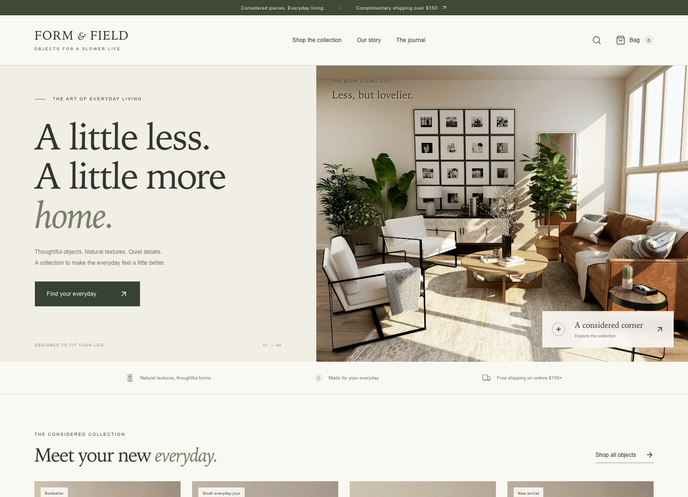
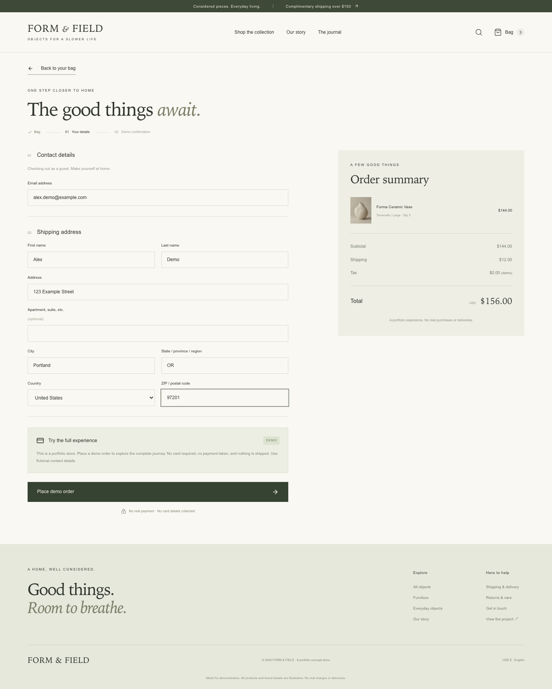
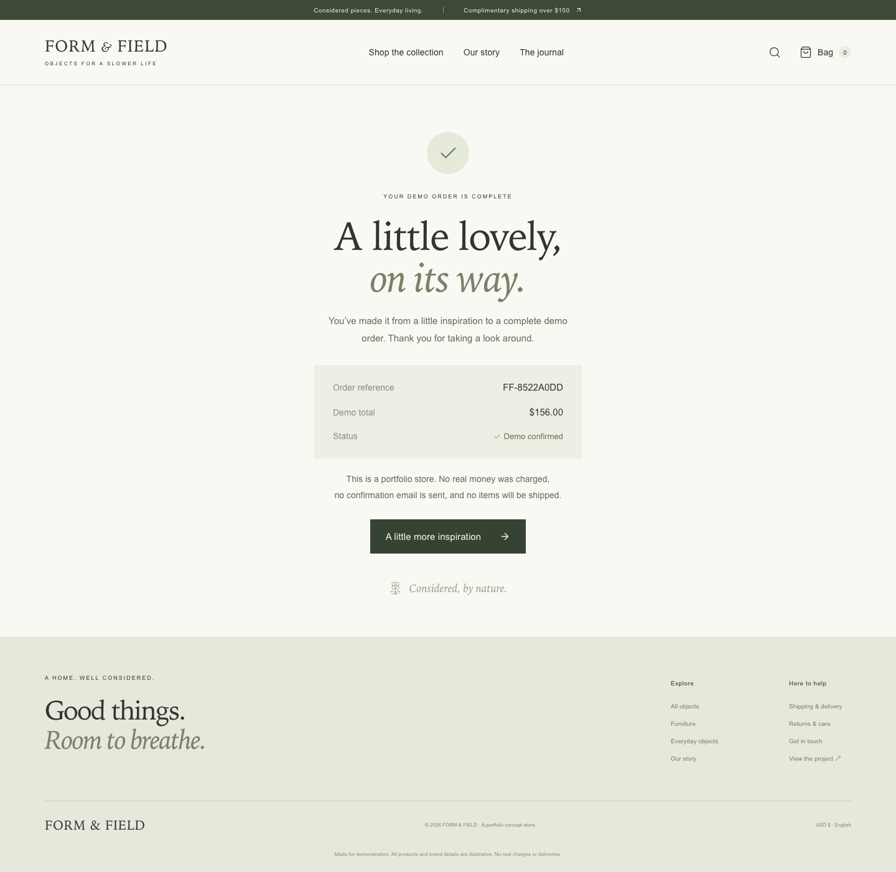
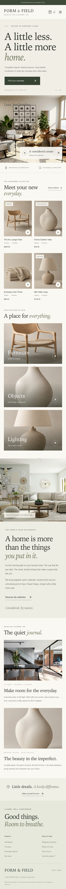

# FORM & FIELD

### A considered collection. A complete shopping experience.

A warm, editorial ecommerce storefront for a fictional homewares brand. Built to demonstrate the full customer journey: discover a product, choose a finish and size, manage a persistent shopping bag, and complete guest checkout.

**Next.js App Router · TypeScript · React · Tailwind CSS · Stripe Checkout**



## Try the experience

Browse eight objects across furniture, ceramics, textiles, and lighting. Search or filter the collection, choose product variants, add an item to your bag, and place a clearly labeled demo order. It takes about two minutes; no account or payment card is needed.

- **Public demo target:** [FORM & FIELD on GitHub Pages](https://iamzhangjinpeng.github.io/form-and-field-storefront/) — published when GitHub Pages is enabled and the included deployment workflow succeeds.
- **Full-stack deployment:** import this repository into Vercel to enable the server-side Stripe integration. A test secret key is required for actual Stripe test payments.

> This is a portfolio concept. Products, prices, policies, and brand details are illustrative. No real money is charged, no emails are sent, and no products are shipped.

## What works

- A responsive, English-language storefront with a coherent visual identity and locally bundled photography.
- Eight product pages with descriptions, finish and size selection, quantities, material details, and related products.
- Category filtering, text search, price sorting, and helpful empty states.
- A versioned `localStorage` shopping bag that survives refreshes, merges identical variants, and supports quantity changes and removal.
- Guest checkout with contact and shipping validation, server-owned catalog prices, and consistent shipping calculations.
- **Stripe test mode:** a server-created Checkout Session, hosted payment page, cancel/retry flow, and server-verified payment confirmation.
- **No-key demo mode:** a clearly identified, card-free simulated order that works on a static host and a fresh local checkout.
- Loading states, accessible form labels, keyboard navigation, focus states, reduced-motion support, and mobile navigation.

## Run locally

Requires Node.js 22.12+ and npm.

```sh
npm ci
cp .env.example .env.local
npm run dev
```

Open [localhost:3006](http://localhost:3006). Leaving `STRIPE_SECRET_KEY` blank selects demo checkout.

For a production build:

```sh
npm run build
npm start
```

## Enable Stripe test payments

1. Create or select a Stripe sandbox and copy its **test secret key** into your local `.env.local` or Vercel environment variables.
2. Set `STRIPE_SECRET_KEY=sk_test_…` and `SITE_URL` to the application's origin, such as `http://localhost:3006` or your Vercel URL. Restart or redeploy after changing environment variables.
3. Add an item, complete the guest form, and continue to the Stripe-hosted page.
4. Use `4242 4242 4242 4242`, any future expiry, and any three-digit CVC. The success page retrieves and verifies the test session on the server.

Only test keys are accepted. The secret stays on the server and must never use a `NEXT_PUBLIC_` variable. Live keys are rejected. No payment-card details are collected by the storefront. Prices and allowed variants are validated against the catalog rather than trusted from the browser.

This demo deliberately has no inventory, fulfillment system, customer accounts, or order database. A production store would add durable orders, signed Stripe webhooks, idempotent fulfillment, tax handling, and abuse controls before accepting real payments. The success page is a customer-facing verification step, not a fulfillment system.

See [Stripe’s Checkout documentation](https://docs.stripe.com/payments/checkout/quickstarts) for the hosted-payment integration.

## Deploy to Vercel

1. Import this GitHub repository into Vercel.
2. Keep the detected **Next.js** preset, `npm run build`, and default output settings.
3. Deploy without secrets for demo mode, or add a Stripe test key and `SITE_URL` for test payments.
4. Redeploy after setting the final `SITE_URL`.

No Supabase account is needed. The catalog lives in `lib/products.ts`; the anonymous shopping bag uses browser storage, as allowed by the product brief.

## Deploy the static portfolio to GitHub Pages

Pushes to `main` validate the source, run tests, check the production build, and export a static demo. They do not publish a website.

To publish later, select **GitHub Actions** in repository **Settings → Pages → Build and deployment**. Then open **Actions → Validate and deploy portfolio → Run workflow**, select **Publish to GitHub Pages**, and run it. Publishing is optional and disabled by default, so source-only portfolio repositories keep passing checks without enabling Pages.

```sh
npm run build:pages
```

The exporter removes server API routes from the static build and restores them afterward. Static checkout is explicitly simulated; GitHub Pages cannot run Stripe server routes. The default path is `/form-and-field-storefront`. Override `NEXT_PUBLIC_BASE_PATH` when using another repository name or a custom domain. Do not run the normal and static builds concurrently.

## Verification

```sh
npm test                 # Pricing, variants, quantities, shipping, input validation
npm run typecheck
npm run build            # Production compilation and route generation
```

Browser checks require Playwright Chromium and a running demo-mode server:

```sh
npx playwright install chromium
npm run test:e2e
```

Set `TEST_URL` for another server, or `PLAYWRIGHT_EXECUTABLE_PATH` for an existing Chromium installation. The browser script exercises catalog filtering/search, product options, cart persistence, quantities, checkout, success handling, mobile navigation, and layouts at 390px and 320px. It saves screenshots in `docs/images/`.

Actual Stripe payment execution requires your own Stripe sandbox credentials and is a separate manual acceptance check. No live payment credentials are included in this repository.

## A closer look

| Collection                                     | Product detail                              |
| ---------------------------------------------- | ------------------------------------------- |
|  |  |

| Guest checkout                              | Order confirmation                                  |
| ------------------------------------------- | --------------------------------------------------- |
|  |  |

<details>
<summary>Mobile storefront</summary>



</details>

## Project structure

```text
app/                       App Router pages and server route handlers
  api/checkout/            Create Stripe test Checkout Sessions
  api/session/             Verify a completed test payment
  products/[id]/           Product detail and static route generation
  cart/ checkout/ success/ Customer purchase journey
components/                Shared shell, catalog, bag and checkout UI
lib/                       Typed catalog, validation, pricing, Stripe integration
public/images/             Local image assets; no runtime image-service dependency
scripts/                   Static export and browser verification
tests/                     Order validation and price integrity tests
docs/                      Screenshots, image provenance and handoff notes
```

Concept product photography combines AI-generated catalog images and Unsplash lifestyle photography. See [image provenance](docs/image-provenance.md) for sources and prompts.
